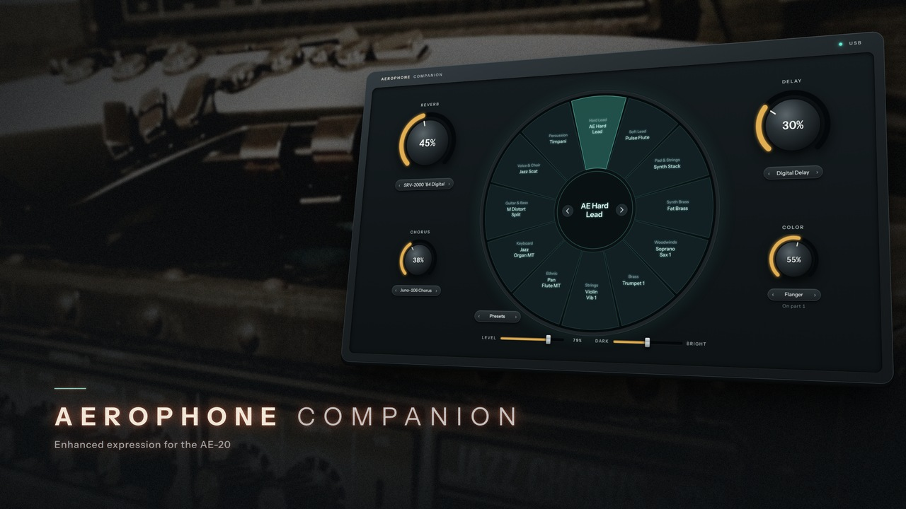
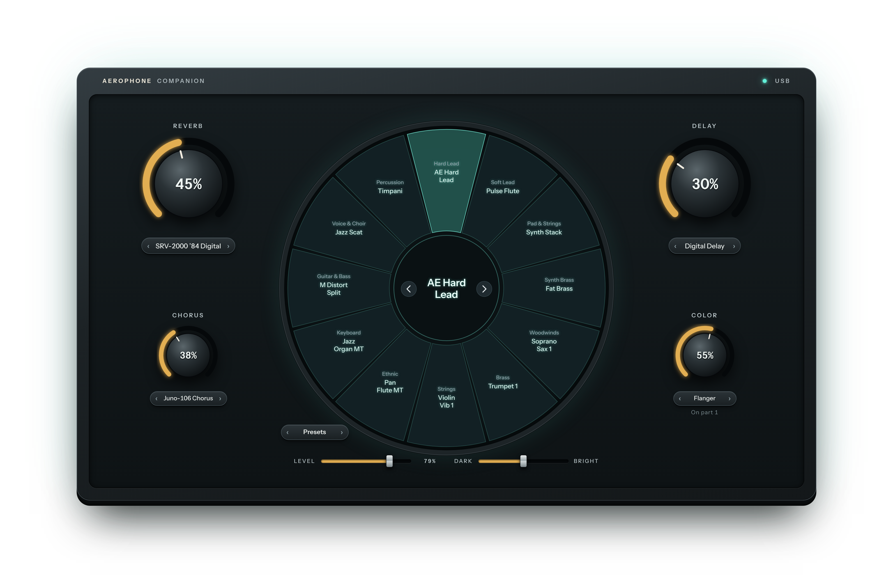
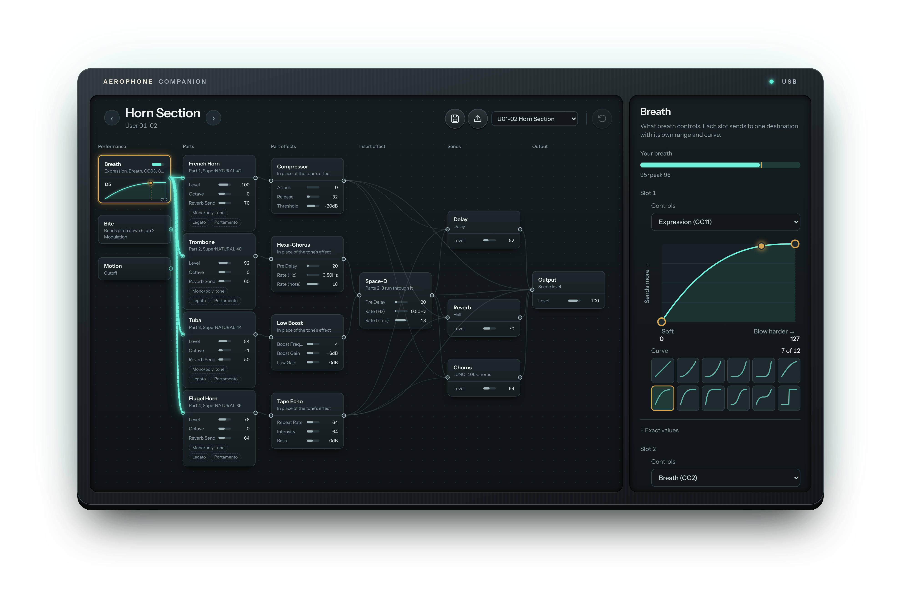

<p align="center">
  
</p>

<h1 align="center">Aerophone Companion</h1>

<p align="center">
  <b>Enhanced expression for the Roland AE-20.</b><br>
  A free, browser-based companion for exploring, shaping and organising your sounds.
</p>

<p align="center">
  <a href="LICENSE.txt"></a>
  
  
  
  
  
  <a href="https://github.com/wrongwaycorrigan/aerophoneCompanion/stargazers"></a>
</p>

<p align="center">
  <a href="https://github.com/wrongwaycorrigan/aerophoneCompanion/archive/refs/heads/main.zip"><b>Download</b></a> ·
  <a href="#getting-started">Getting started</a> ·
  <a href="#what-it-does">What it does</a> ·
  <a href="#license-and-no-warranty">License</a>
</p>

---

Aerophone Companion unlocks the potential of the Roland AE-20 Digital Wind Instrument with an intuitive, browser-based app. It talks to your instrument over USB using SysEx, the messages the AE-20 already understands.

It's made for the composing side of things: at the computer, trying sounds against a track and moving quickly from idea to idea.

## What it does

<table>
  <tr>
    <td width="50%" valign="top">
      
    </td>
    <td width="50%" valign="top">
      <h3>Live view</h3>
      A scene wheel for fast access to your saved Favorites, stock Presets or custom User banks. Reverb, delay, chorus and color knobs are within easy reach to shape the sound as you play.
    </td>
  </tr>
  <tr>
    <td width="50%" valign="top">
      <h3>Scene editor</h3>
      Open up any scene and explore the depth of tones and effects the instrument keeps under the hood. Follow the signal flow, go tone chasing and make the sound your own. Live breath data visualization makes it easier to adjust for your performance style.
    </td>
    <td width="50%" valign="top">
      
    </td>
  </tr>
</table>

### Tones
Go further and explore the tones that create a scene. It's the deepest layer of the AE-20, made easy to explore: oscillators, filters and amps are revealed visually, and every partial shows the name of the wave it plays. Browse and search all 1,980 built-in waves, add or remove partials, **solo** one to hear it on its own, or start a **New tone** from scratch. Save an edited tone to one of the 512 user tone slots, or save it to your computer as a **ZENOLOGY** bank file to keep shaping it in Roland's plug-in.

### Library
Your AE-20's sound vault. Import, export, organise and back up every scene, then send whole collections to the instrument in one go. Backup only reads from the AE-20, so nothing gets overwritten until you choose.

## Getting started

You need a Roland AE-20, a USB-C **data** cable, and Chrome or Edge on Windows or macOS.

1. If your computer doesn't list the AE-20 as a MIDI device, install the Aerophone USB driver (roland.com › Support › Aerophone AE-20 › Updates & Drivers).
2. Connect the AE-20 and turn it on. Close Roland's phone app (or turn Bluetooth off on the AE-20) so the two don't compete.

### Run it

No install or build step, and no internet connection needed. Windows uses its built-in PowerShell; macOS and Linux need Python 3.

**Download:** [**⬇ Download ZIP**](https://github.com/wrongwaycorrigan/aerophoneCompanion/archive/refs/heads/main.zip), then extract it. This is the easiest way.

**Or with git:**

```sh
git clone https://github.com/wrongwaycorrigan/aerophoneCompanion.git
cd aerophoneCompanion
```

Then start the app in that folder:

| System | Double-click | Or in a terminal |
| --- | --- | --- |
| Windows | `Start Aerophone Companion (Windows).bat` | `powershell -ExecutionPolicy Bypass -File serve.ps1` |
| macOS | `Start Aerophone Companion (Mac).command`<br>(right-click › Open the first time) | `sh "Start Aerophone Companion (Mac).command"` |
| Linux (untested) | | `cd app && python3 -m http.server 8642 --bind 127.0.0.1` |

The app opens at [http://localhost:8642](http://localhost:8642) in Chrome or Edge (on Linux, open it yourself). Keep the server window open while you play. When the browser asks to *control and reprogram your MIDI devices*, click **Allow**.

> [!TIP]
> **Back up first.** In Library, click **Back up** on the AE-20 side. It reads every user scene and your 12 favorites into a dated library on your computer and changes nothing on the instrument. User tones aren't included in the backup.

<details>
<summary><b>Troubleshooting</b></summary>

- **Windows warns about a downloaded file:** right-click the zip › Properties › tick **Unblock**, then extract again.
- **macOS won't open the start script:** right-click it › **Open**, then **Open** again. If it still refuses, open Terminal, type `xattr -d com.apple.quarantine ` (with a space at the end), drag the script onto the window and press Return. Do the same with `chmod +x `.
- **Firefox or Safari:** they can't talk to MIDI devices this way. Use Chrome or Edge.
- **Instrument unplugged or switched off:** the status light at the top right shows it. Click the light to reconnect.
- **Where your Library lives:** in the browser at `http://localhost:8642`. Export anything you want to keep as files.
- **Reporting a problem:** include the version and build code shown next to the app's name (for example `v0.14.0 · 5d1212b`).

</details>

<details>
<summary><b>What's inside</b></summary>

| Folder | What it is |
| --- | --- |
| `app/` | The app itself. `app/data.js` holds facts about the AE-20 (parameter addresses, ranges, effect types and settings, tone names), built from Roland's public documents for the AE-30/AE-20: the MIDI Implementation, the Parameter Guide and the Scene List. Scene and user tone names are read from your instrument. |
| `tools/` | Rebuilds `app/data.js` from newer editions of those documents. Needs Python 3, `pdftotext` and the `pdfplumber` package. |
| `docs/images/` | Images for this page. |

```sh
python3 tools/build_data.py "MIDI Implementation.pdf" "Parameter Guide.pdf" "Scene List.pdf" app/data.js
python3 tools/stamp.py app
```

</details>

## License and no warranty

Released under the [MIT License](LICENSE.txt). Aerophone Companion is free software provided "as is", without warranty of any kind. The author isn't liable for any damages, including loss or corruption of scenes, tones, settings or other data on your instrument or computer, or damage to equipment. See [LICENSE.txt](LICENSE.txt) for the full terms.

<sub>Aerophone Companion is an independent, open source project and isn't affiliated with or endorsed by Roland. Roland and Aerophone are trademarks of Roland Corporation. Made with the help of Anthropic's Claude Code.</sub>
